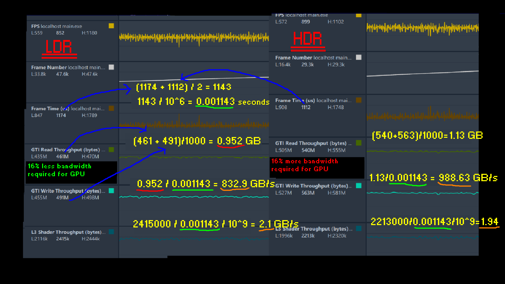

import Float16Visualizer from '../../components/Float16Visualizer.astro';
import bloomCompare from '../../assets/reports/01-bloom/hdr-vs-ldr.png';

*Dear Princess Celestia,*

Today I learned how modern games make bright shapes glow without blowing up GPU bandwidth—and why 8-bit color channels betray you the moment you turn up bloom intensity...

## 1. The 5-Mip Bloom Pipeline
* Prefilter with a soft quadratic knee (`threshold`)
* 13-tap Jimenez downsample across 5 mip levels
* Additive upsample + final composite

```glsl
// Highlighting the key prefilter knee or 13-tap kernel from myBloom.c
```

## 2. Bugs That Taught Me Things
1. **The Double `BeginDrawing()` Trap:** Why calling `EndDrawing()` inside `ApplyBloom()` and again in `main()` cut my framerate in half and flickered UI text.
2. **The Silent `#version 330` Mistake:** Missing one header line broke `compositeFS` uniform updates.

## 3. HDR (`R16G16B16A16`) vs. LDR (`R8G8B8A8`) & Floating-Point Step Gaps
Explain fixed `1/255` quantization vs. `float16` (`sign + 5-bit exponent + 10-bit mantissa`, `-65504..65504`), and why high `intensity` turns invisible `1/255` steps into hard concentric rims:

<Float16Visualizer />



## 4. Profiling Notes (RenderDoc & Intel GPA)
* Bloom cost on Intel UHD Graphics at 720p: **~0.52 ms** (`+10.8 MB/frame`)
* `R16G16B16A16` HDR cost over `R8G8B8A8`: **~0.08 ms/frame** (`+1.7` to `+5.1 MB/frame`, depending on whether `canvas` is kept 8-bit hybrid!)
* Next experiment: `R11G11B10_FLOAT` for 32-bit HDR mipmaps.

```